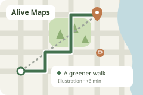

  

# Alive Maps

  

Didn't work? Create a Studio workspace and paste this to your agent:
` /use-template https://github.com/majawilbrink/alive-maps`

## Why you care

When you have a little extra time, the shortest walk is not always the one you want. Alive Maps helps you compare routes that favor mapped greenery, views, cafes, shops, and cultural places.

## How to use it

1. Open Alive Maps in your Studio workspace. Try the built-in public San Francisco example, or search for each address and explicitly choose a result. You can also place pins on the map.
2. Set an extra-time budget from 0 to 30 minutes, then compare Direct, Scenic, Lively, and A bit of both.
3. Inspect the walking directions, nearby mapped places, and original map records. Download the selected path as a GPX track if useful.

Choose endpoints no more than 2.5 km apart. Dense areas may require a shorter walk. This plans walks; it does not provide live navigation. Mapped greenery and venues are clues, not live crowd reports or guaranteed views. Stairs may be included; accessibility, live closures, safety, and gradients are not evaluated. Dotted pin connections are unverified, and GPX downloads include only the mapped path.

Setup needs an Imbue Studio workspace, its normal Python app installation, and internet access to the public Photon and OpenStreetMap services. No paid keys, sign-ins, or AI model access are needed. If port 8084 is already in use, your agent must choose another port and update the launch settings. Personal searches and route history do not ship with the template.

## Ideas for making it yours

- Replace the San Francisco example with public endpoints in your neighborhood.
- Tune the greenery and street-life weights to suit your preferred walks.
- Adjust walking-speed estimates for your usual pace.
- Add another explainable preference, such as routes near public art or playgrounds.

## What this is

This repository is a published **Imbue Studio template**: a clean, bootable
snapshot of what an agent built, ready to adapt into your own. It is NOT the
generic workspace template -- it is this specific project.

[`template.md`](template.md) is the full manifest -- what it is, how it
works, what it needs to run, and what to adapt -- with the
machine-readable half (recipe, requirements, and the environment it needs
installed) in [`template.toml`](template.toml).

## License

The original Alive Maps app, icon, and template-specific documentation and artwork
are available under the [MIT license](LICENSE). Bundled Leaflet and inherited
workspace components retain their own terms. In particular, the workspace shell
uses its [Fair Core License](system/apps/system_interface/LICENSE).
See [third-party notices](THIRD_PARTY_NOTICES.md) for the other bundled notices.
